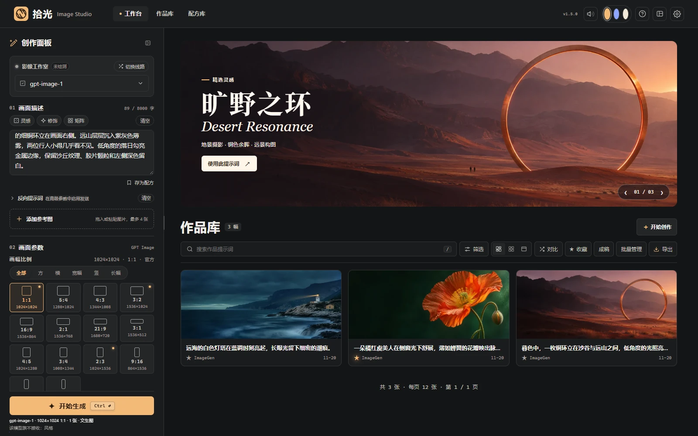
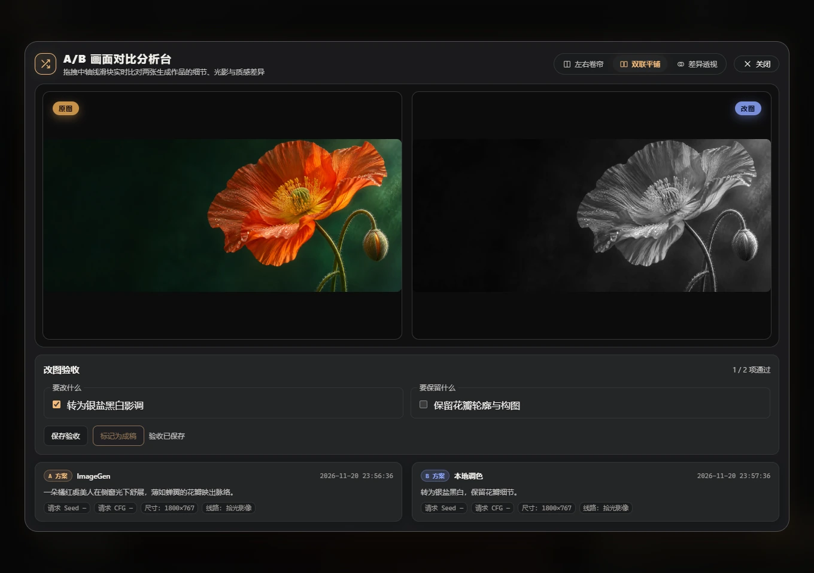

<div align="center">

# 拾光 · AI Image Studio

**点开一张旧图，找回当时的提示词和参数，从那里改下一版。**

拾光是一个本地 AI 图像工作台。接上自己的生图 API，在桌面浏览器里生成、选片、改图和交付。

[快速开始](#快速开始) · [看一次改图](#看一次改图) · [自定义工作台](#自定义工作台) · [English](README_EN.md)

<sub>v1.5.0　·　Python 3.10+　·　MIT 开源</sub>

</div>

[](screenshots/studio.webp)

## 下次还能找到这张图吗？

| 创作时遇到的事 | 在拾光里怎么做 |
| --- | --- |
| 好图已经下载了，想再做一组，却想不起用的提示词和模型。 | 点开作品就能读到当时记录的生成参数。选「复用全部参数」回到创作面板，也可以将常用组合命名为配方。 |
| 只想换个色调，第二版却连构图也变了。 | 从原图点「基于此图改一版」，分别写下要改和要保留的内容。把两版并排或拖动分割线，自己逐项验收。 |
| 交付前又得翻目录、找最终版，再复制一遍参数。 | 筛选「成稿」，跨页勾选作品。下载的 ZIP 里有原图和 `manifest.json`，参数随图一起交付。 |

## 看一次改图

下面是一个植物静物示例。左边是橙红色虞美人，右边是用同一张原图在本机制作的黑白版。截图取自拾光的实际验收界面。

[](screenshots/review.webp)

**「转为银盐黑白影调」已勾选，「保留花瓣轮廓与构图」还在等人确认。** 两项都通过后，就能标记成稿。下次打开作品，仍能沿版本记录找到原图。

## 快速开始

准备 **Python 3.10 或更高版本**。普通电脑即可运行工作台。浏览界面、试用布局和准备提示词时无需连接服务。实际生图需要兼容服务的 API Key，费用按服务商规则结算。

```bash
git clone https://github.com/lmz-666-lmz/aiimage-studio.git
cd aiimage-studio
python -m pip install -r requirements.txt
python app.py
```

浏览器会自动打开 [本地工作台](http://127.0.0.1:7860/)。也可以[下载源码 ZIP](https://github.com/lmz-666-lmz/aiimage-studio/archive/refs/heads/main.zip)，解压后在 `app.py` 所在目录执行最后两行。

1. **连接服务。** 点右上角齿轮，在中转站设置里添加 API 地址和密钥。文生图使用 OpenAI 兼容的 `/v1/images/generations`，改图还需要 `/v1/images/edits`。
2. **生成第一张。** 选模型，写下画面描述，或从精选灵感点「使用此提示词」。按 `Ctrl + Enter` 生成。支持的模型可一次请求最多 4 张，也可添加最多 4 张参考图。
3. **留住这次设置。** 点「存为配方」保存提示词和参数，下次从顶栏「配方库」载入。用到参考图时可以重新添加图片文件。

## 自定义工作台

点顶栏的布局图标，可以先试「经典创作」「右侧修图」或「双栏选片」。要做精细调整，选「在工作台上调整」，拖动分区标题换序、拖动底边改高度；侧栏边界也可以直接拖宽。将结果命名保存，就能在修图和选片之间切换。

[](screenshots/layout.webp)

工作台含暮金、黛夜、宣纸、青瓷、莓夜、海盐六套主题，可在设置里切换。

## 文件和数据放在哪里？

| 内容 | 保存位置 |
| --- | --- |
| 原图、提示词、生成参数、收藏、改图关系与验收记录 | 项目下的 `outputs/`，图片旁有同名 JSON。 |
| 生图服务地址、密钥、当前主题 | 本机 `config.json`。可通过设置页管理，也可参考[配置示例](config.example.json)。 |
| 命名配方、命名布局 | 当前浏览器的本地存储。请用同一个浏览器和工作台地址打开。 |

<details>
<summary><b>使用前还想确认几件事</b></summary>

- **哪些数据会发给服务商？** 生成时会向所选服务发送 API 密钥、提示词和本次请求使用的参考图。工作台默认监听本机 `127.0.0.1`。请使用可信且证书有效的服务地址，当前客户端遇到证书校验失败会降级重试。
- **更换模型后为什么少了选项？** 画幅、参考图和高级参数按模型能力显示。历史记录保存的是请求值，Seed、CFG 等扩展参数是否生效取决于服务商。
- **批量生成中刷新怎么办？** 刷新当前标签页后，拾光会继续查询服务端保留的批量或改图任务。已经写入磁盘的作品可在作品库查看。

</details>

遇到兼容问题，欢迎在 [Issues](https://github.com/lmz-666-lmz/aiimage-studio/issues) 附上模型名、操作步骤和已去除密钥的报错信息。项目采用 [MIT 许可证](LICENSE)。
