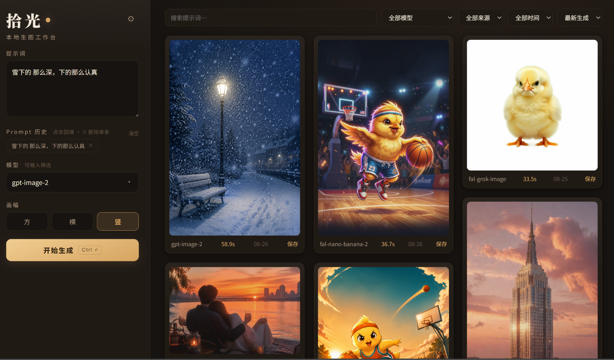
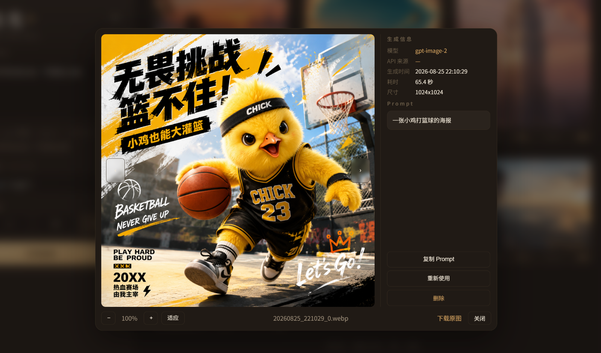
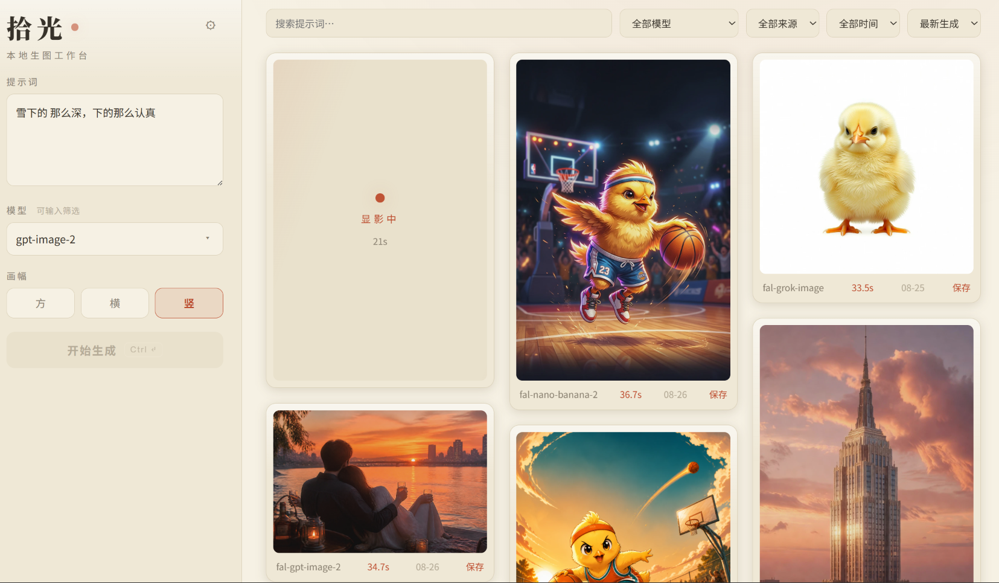
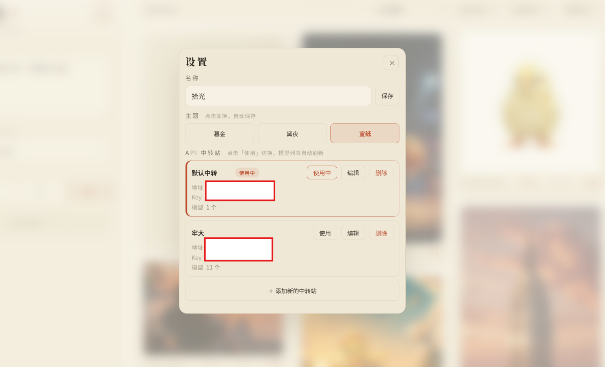
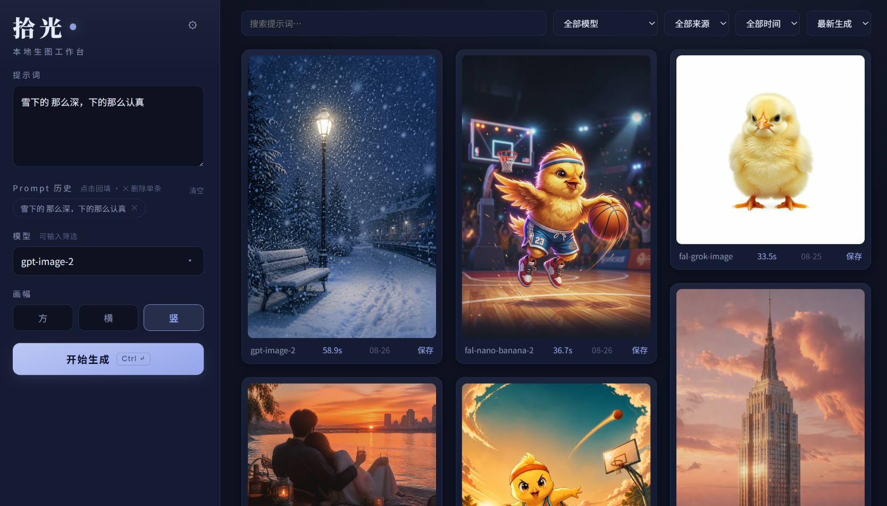
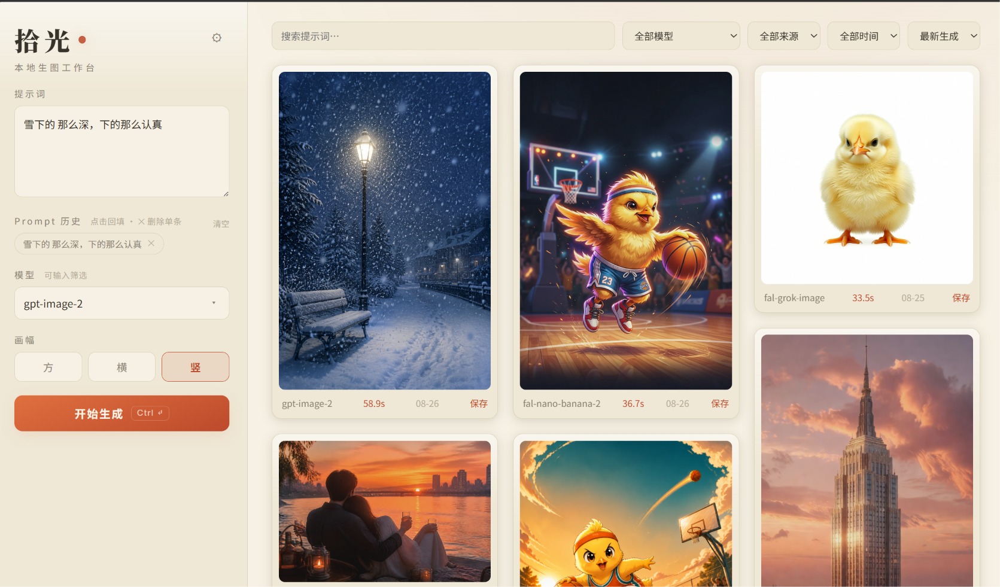

<div align="center">
  
  <h1>Image Studio</h1>
  <p><b>🌕 拾光 · 本地生图工作台</b></p>
  <p><b>输入一句话，看照片在暗房里慢慢显影</b></p>
  <p>
    <code>Flask</code> · <code>原生 JS</code> · <code>GSAP</code> · <code>OpenAI 兼容中转站</code> · <code>无构建依赖</code>
  </p>
  <p>
    <a href="https://www.python.org/"></a>
    <a href="https://flask.palletsprojects.com/"></a>
    <a href="LICENSE"></a>
  </p>
  <p>
    <a href="#-解决了什么问题">解决的问题</a> ·
    <a href="#-快速开始">快速开始</a> ·
    <a href="#-效果预览">预览</a> ·
    <a href="#-三套主题">主题</a> ·
    <a href="#️-配置">配置</a> ·
    <a href="#-常见问题">常见问题</a>
  </p>
</div>

---

## 🎯 解决了什么问题

现在想用上生图 API 并不轻松：

- **接口碎片化** —— OpenAI 有 Images API，fal 有自己的队列协议，各家模型参数、返回格式（URL / b64）都不一样，换个模型就要改一次代码
- **配置门槛高** —— 密钥、Base URL、模型名散落在环境变量和脚本里，想快速试一个新模型，得先写一遍调用代码
- **Agent 工具的盲区** —— Codex、Cursor 这类编码 Agent 擅长写代码，但「调生图 API → 存文件 → 打开看效果 → 不满意调参数重来」这条链路每次都要现写脚本：看不到图、管不住历史，迭代效率很低

**Image Studio 把这些一次性解决**：填入中转站地址 + 密钥，所有 OpenAI 兼容的生图模型即插即用；多个中转站可并存管理，一键切换——

| 没有它 | 有了它 |
|---|---|
| 每个模型写一遍调用脚本 | 模型列表自动拉取，下拉切换 |
| 参数和密钥散落在代码里 | 多中转站统一管理，一键切换，改完即生效 |
| 生成结果散落在临时目录 | 瀑布流历史墙，模型/耗时/提示词全标注 |
| 看图要手动打开文件 | 灯箱缩放平移，← → 键对比不同模型的出图 |

对 Agent 工具用户来说，它就是那块缺失的「可视化出图面板」：让 Codex 帮你写代码，让 Image Studio 帮你看图。

## ✨ 功能一览

| | 功能 | 说明 |
|---|---|---|
| 🎨 | **多模型生图** | 自动拉取中转站全部生图模型（gpt-image / nano-banana / seedream / grok-image…），**输入即筛选**、最近使用置顶，也可直接手填模型名 |
| 🔌 | **多中转站管理** | 添加 / 编辑 / 删除 / 一键切换任意多个 OpenAI 兼容中转站，切换后模型列表自动刷新；旧版单站配置自动迁移 |
| 🖼 | **瀑布流印相墙** | 小红书式自适应瀑布流，卡片悬浮上浮；每张图标注**生成模型、耗时与日期**，悬停可看完整提示词 |
| 🔎 | **历史筛选** | 关键词搜提示词，按模型 / API 来源 / 时间（今天·最近7天）过滤，支持最新 / 最快 / 模型名排序 |
| 🌅 | **显影动画** | 生成中显示红光扫过的相纸并实时计时，图片到达时从模糊灰色「显影」为清晰（GSAP 编排，尊重系统减弱动效） |
| 🔍 | **灯箱查看器** | 滚轮以光标为中心缩放（20%–1000%）、拖拽平移、双击缩放、**← → 方向键循环切换**；右侧信息面板展示模型 / 来源 / 时间 / 耗时 / 尺寸 / Prompt，支持复制与一键回填 |
| 📄 | **分页浏览** | 每页 12 张，页码 + 跳页，底部常显「共 N 张 · 每页 12 张 · 第 X / Y 页」 |
| 🌄 | **三套主题** | 暮金 / 黛夜 / 宣纸，**点击即换、自动保存**，无需刷新 |
| ⚙️ | **设置面板** | 名称、主题、中转站列表全部页面内可改，即时持久化 |
| 💾 | **本地留存** | 图片自动存入 `outputs/`，元数据（模型 / 来源 / 耗时 / 提示词 / 尺寸 / 时间）写入同名 `.json` |

## 🚀 快速开始

```bash
git clone https://github.com/lmz-666-lmz/image-studio.git
cd image-studio
pip install -r requirements.txt
python app.py          # 自动打开 http://127.0.0.1:7860
```

首次进入会自动弹出设置面板：

1. 点「＋ 添加新的中转站」，填入地址（任意 OpenAI 兼容中转，如 new-api / one-api 部署）和密钥
2. 点「测试连接」验证，「保存中转站」后自动启用并拉取模型列表
3. 写一句提示词，`Ctrl + Enter` 开始生成 ✨

## 🖼 效果预览

<div align="center">

**主界面 · 暮金** —— 左侧生成轨，右侧瀑布流印相墙；顶部筛选栏，每张卡片标注模型 / 耗时 / 日期



**灯箱查看器** —— 滚轮缩放 · 拖拽平移 · ← → 切换；右侧信息面板记录模型 / 来源 / 时间 / 耗时 / 尺寸 / Prompt，支持复制与一键回填



<table>
  <tr>
    <td width="50%" align="center"><br><sub><b>显影动画</b> —— 添加 / 编辑 / 一键切换</sub></td>
    <td width="50%" align="center"><br><sub><b>多中转站管理</b> —— 红光扫过，实时计时</sub></td>
  </tr>
</table>

</div>


## 🌄 三套主题

| 主题 | 键值 | 气质 |
|:---:|:---:|---|
| 🌇 **暮金** | `darkroom` | 暖炭底色，烛金安全灯，胶片暗房的温度 |
| 🌌 **黛夜** | `ink` | 黛蓝夜幕，月紫微光，安静克制的深色 |
| 📜 **宣纸** | `paper` | 米纸底，朱砂印红，东方文房的素净 |

<div align="center">

<p>
  
  
  
</p>

<sub>暮金 · 黛夜 · 宣纸 —— 点击即换，自动保存，无需刷新</sub>

</div>

## ⚙️ 配置

全部设置保存在 `image-studio/config.json`，页面里改即可，也可直接编辑：

```jsonc
{
  "name": "拾光",              // 工作台的中文显示名
  "theme": "darkroom",         // darkroom 暮金 / ink 黛夜 / paper 宣纸
  "providers": [               // 中转站列表，可有多条
    {
      "id": "provider_1",
      "name": "官方中转",
      "api_base": "https://…", // OpenAI 兼容中转站地址
      "api_key": "sk-…",       // 对应密钥
      "models": []             // 该站可用生图模型（自动拉取缓存）
    }
  ],
  "active_provider": "provider_1"
}
```

## 📁 项目结构

```
image-studio/
├── app.py              # Flask 后端：中转站管理、生图代理、历史筛选、设置持久化
├── requirements.txt    # Python 依赖（仅 Flask）
├── LICENSE             # MIT License
├── config.json         # 你的配置（含密钥，勿提交，已加入 .gitignore）
├── static/
│   ├── index.html      # 页面结构
│   ├── style.css       # 三主题 + 瀑布流 + 灯箱样式
│   ├── app.js          # 生成 / 分页筛选 / 中转站管理 / 灯箱缩放切换 / GSAP 动效
│   └── assets/         # Logo 与浏览器标签页图标（favicon）
├── screenshots/        # 效果图
└── outputs/            # 生成图片自动保存到这里
```

## ❓ 常见问题

<details>
<summary><b>生成竖图时主体顶部被裁掉？</b></summary>

这是部分模型（如 nano-banana-lite）在竖版画幅下的出图缺陷，不是查看器的问题——下载原文件即可验证。换 `gpt-image` 或 `seedream` 系模型可避免。
</details>

<details>
<summary><b>模型列表加载失败？</b></summary>

先在设置里「测试连接」。模型列表在服务端缓存 10 分钟，上游偶发抖动时会自动回退到上次结果，不会白屏。
</details>

<details>
<summary><b>换了一个中转站？</b></summary>

设置里「＋ 添加新的中转站」或对已有条目点「编辑」→ 保存。多个中转站并存时，点「使用」即可切换，模型列表自动重拉，无需重启。
</details>

<details>
<summary><b>升级到新版后原来的 API 配置还在吗？</b></summary>
在。首次启动会自动把旧的 `api_base` / `api_key` 迁移成一个名为「默认中转」的中转站，并设为使用中。
</details>

<details>
<summary><b>中转站地址要带 <code>/v1</code> 吗？</b></summary>

带不带都可以。应用会自动补全 `/v1/models` 等路径，填 `https://example.com` 或 `https://example.com/v1` 效果相同。
</details>

<details>
<summary><b>提示「HTTPS 证书已过期或无效」？</b></summary>

部分小型中转站的证书维护不规范，应用遇到证书错误会自动跳过校验完成请求，并在界面给出提示。密钥仍按原样发送，介意风险的话建议换用证书正常的站点。
</details>

<details>
<summary><b>为什么中文名叫「拾光」？</b></summary>
拾起光，也谐音「时光」——每一张生成的照片，都是被拾起的一段光。
</details>

---

<div align="center">

**Image Studio · 拾光** —— 把每一次生成，都当作在暗房里洗出的一张照片

用 [Flask](https://flask.palletsprojects.com/) 与 [GSAP](https://gsap.com/) 构建 · 觉得有用就点个 ⭐

</div>
