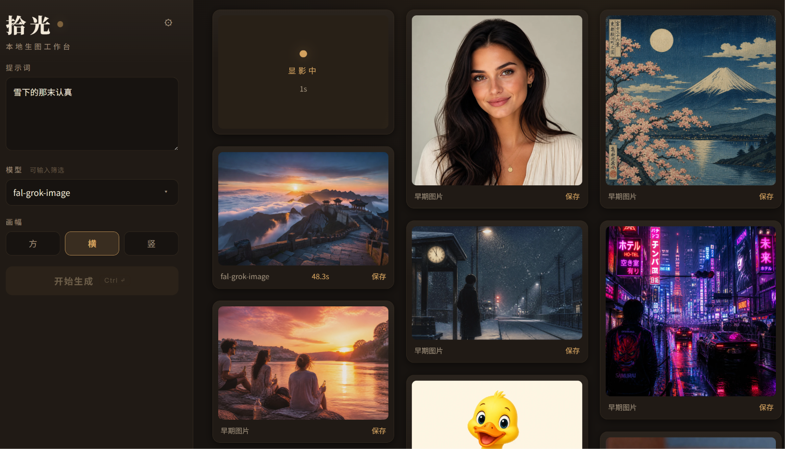
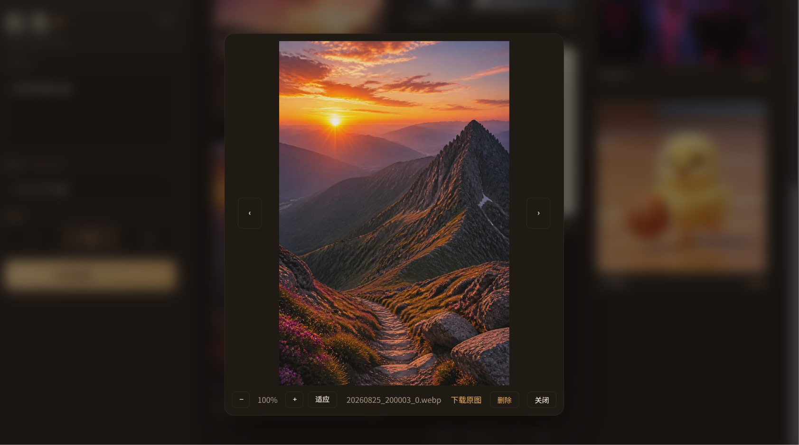
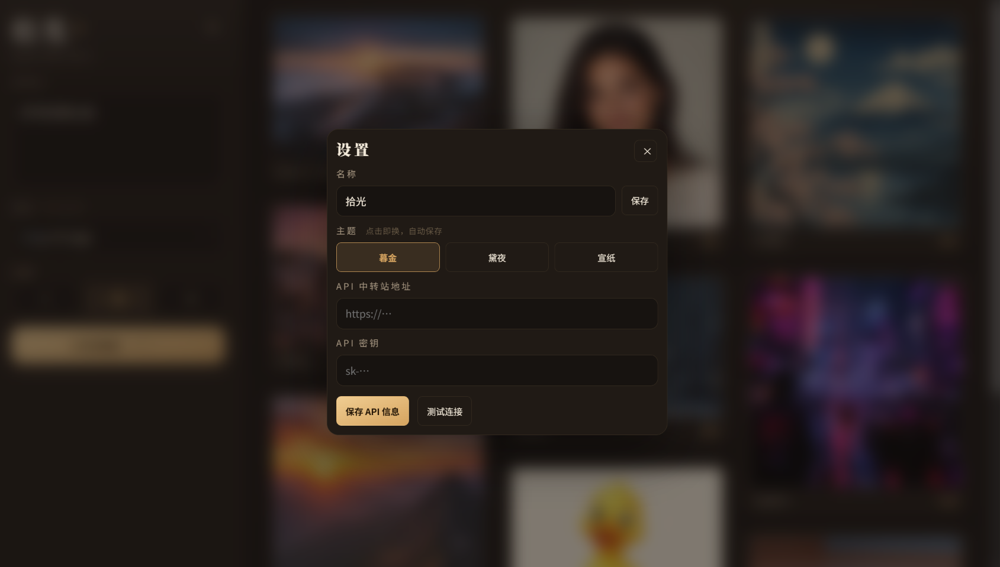
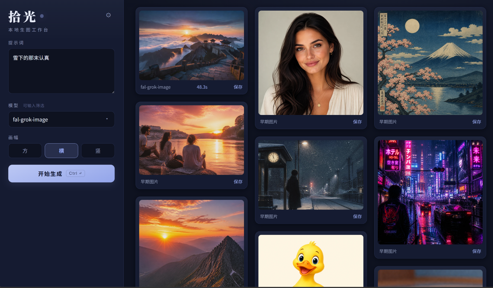
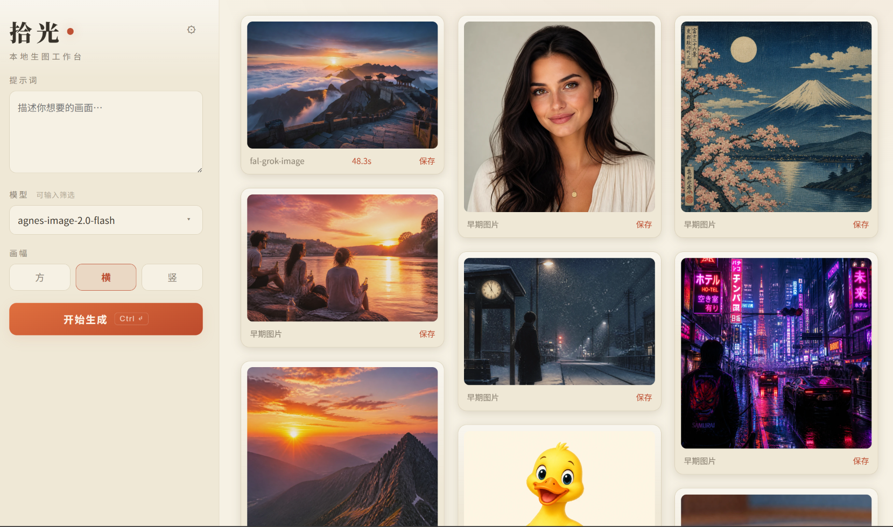
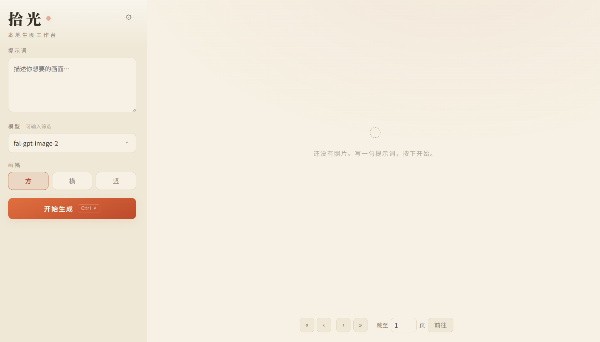

<div align="center">

# Image Studio

### 🌕 拾光 · 本地生图工作台

**输入一句话，看照片在暗房里慢慢显影**

`Flask` · `原生 JS` · `GSAP` · `OpenAI 兼容中转站` · `无构建依赖`

[](https://www.python.org/)
[](https://flask.palletsprojects.com/)
[]()

[解决的问题](#-解决了什么问题) · [快速开始](#-快速开始) · [预览](#-效果预览) · [主题](#-三套主题) · [配置](#️-配置) · [常见问题](#-常见问题)

</div>

---

## 🎯 解决了什么问题

现在想用上生图 API 并不轻松：

- **接口碎片化** —— OpenAI 有 Images API，fal 有自己的队列协议，各家模型参数、返回格式（URL / b64）都不一样，换个模型就要改一次代码
- **配置门槛高** —— 密钥、Base URL、模型名散落在环境变量和脚本里，想快速试一个新模型，得先写一遍调用代码
- **Agent 工具的盲区** —— Codex、Cursor 这类编码 Agent 擅长写代码，但「调生图 API → 存文件 → 打开看效果 → 不满意调参数重来」这条链路每次都要现写脚本：看不到图、管不住历史，迭代效率很低

**Image Studio 把这些一次性解决**：填一个中转站地址 + 一把密钥，所有 OpenAI 兼容的生图模型即插即用——

| 没有它 | 有了它 |
|---|---|
| 每个模型写一遍调用脚本 | 模型列表自动拉取，下拉切换 |
| 参数和密钥散落在代码里 | 设置面板统一管理，改完即生效 |
| 生成结果散落在临时目录 | 瀑布流历史墙，模型/耗时/提示词全标注 |
| 看图要手动打开文件 | 灯箱缩放平移，← → 键对比不同模型的出图 |

对 Agent 工具用户来说，它就是那块缺失的「可视化出图面板」：让 Codex 帮你写代码，让 Image Studio 帮你看图。

## ✨ 功能一览

| | 功能 | 说明 |
|---|---|---|
| 🎨 | **多模型生图** | 自动拉取中转站全部生图模型（gpt-image / nano-banana / seedream / grok-image…），**输入即筛选**，也可直接手填模型名 |
| 🖼 | **瀑布流印相墙** | 小红书式自适应瀑布流，卡片悬浮上浮；每张图标注**生成模型与耗时**，悬停可看完整提示词 |
| 🌅 | **显影动画** | 生成中显示红光扫过的相纸并实时计时，图片到达时从模糊灰色「显影」为清晰（GSAP 编排，尊重系统减弱动效） |
| 🔍 | **灯箱查看器** | 滚轮以光标为中心缩放（20%–1000%）、拖拽平移、双击缩放、**← → 方向键循环切换**、下载与删除 |
| 📄 | **分页浏览** | 每页 12 张，页码 + 跳页，底部常显「共 N 张 · 每页 12 张 · 第 X / Y 页」 |
| 🌄 | **三套主题** | 暮金 / 黛夜 / 宣纸，**点击即换、自动保存**，无需刷新 |
| ⚙️ | **设置面板** | 名称、主题、API 地址与密钥全部页面内可改，即时持久化；改站点后模型列表自动刷新 |
| 💾 | **本地留存** | 图片自动存入 `outputs/`，元数据（模型/耗时/提示词/尺寸）写入同名 `.json` |

## 🚀 快速开始

```bash
git clone <this-repo>
cd image-studio
pip install flask
python app.py          # 自动打开 http://127.0.0.1:7860
```

首次进入会自动弹出设置面板：

1. 填入中转站地址（任意 OpenAI 兼容中转，如 new-api / one-api 部署）
2. 填入 API 密钥，点「测试连接」验证
3. 点「保存 API 信息」，写一句提示词，`Ctrl + Enter` 开始生成 ✨

## 🖼 效果预览

<div align="center">

**暮金 · 瀑布流印相墙** —— 暖炭底色，烛金安全灯；生成中的相纸红光扫过、实时计时，完成后从模糊灰色「显影」为清晰



**灯箱** —— 滚轮缩放 · 拖拽平移 · ← → 切换 · 下载删除



**设置** —— 名称 / 主题 / API 一站式管理



</div>

## 🌄 三套主题

| 主题 | 键值 | 气质 |
|:---:|:---:|---|
| 🌇 **暮金** | `darkroom` | 暖炭底色，烛金安全灯，胶片暗房的温度 |
| 🌌 **黛夜** | `ink` | 黛蓝夜幕，月紫微光，安静克制的深色 |
| 📜 **宣纸** | `paper` | 米纸底，朱砂印红，东方文房的素净 |

<div align="center">

| 黛夜 | 宣纸 |
|:---:|:---:|
|  |  |

**宣纸 · 初始页** —— 空状态也干净



</div>

## ⚙️ 配置

全部设置保存在 `image-studio/config.json`，页面里改即可，也可直接编辑：

```jsonc
{
  "name": "拾光",          // 工作台的中文显示名
  "theme": "darkroom",     // darkroom 暮金 / ink 黛夜 / paper 宣纸
  "api_base": "https://…", // OpenAI 兼容中转站地址
  "api_key": "sk-…"        // 对应密钥
}
```

## 📁 项目结构

```
image-studio/
├── app.py              # Flask 后端：生图代理、历史分页、设置持久化
├── config.json         # 你的配置（含密钥，勿提交）
├── static/
│   ├── index.html      # 页面结构
│   ├── style.css       # 三主题 + 瀑布流 + 灯箱样式
│   └── app.js          # 生成 / 分页 / 灯箱缩放切换 / GSAP 动效
├── screenshots/        # 效果图
└── outputs/            # 生成图片自动保存到这里
```

## ❓ 常见问题

<details>
<summary><b>生成竖图时主体顶部被裁掉？</b></summary>

这是部分模型（如 nano-banana-lite）在竖版画幅下的出图缺陷，不是查看器的问题——下载原文件即可验证。换 `gpt-image` 或 `seedream` 系模型可避免。
</details>

<details>
<summary><b>模型列表加载失败？</b></summary>

先在设置里「测试连接」。模型列表在服务端缓存 10 分钟，上游偶发抖动时会自动回退到上次结果，不会白屏。
</details>

<details>
<summary><b>换了一个中转站？</b></summary>

设置里改地址和密钥 → 保存 → 模型列表自动重拉，无需重启。
</details>

<details>
<summary><b>为什么中文名叫「拾光」？</b></summary>
<<<<<<< HEAD
=======

拾起光，也谐音「时光」——每一张生成的照片，都是被拾起的一段光。
</details>

---

<div align="center">

**Image Studio · 拾光** —— 把每一次生成，都当作在暗房里洗出的一张照片

用 [Flask](https://flask.palletsprojects.com/) 与 [GSAP](https://gsap.com/) 构建 · 觉得有用就点个 ⭐

</div>
