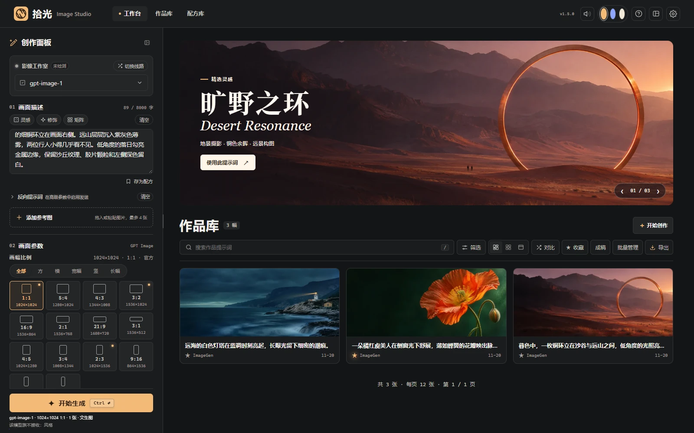
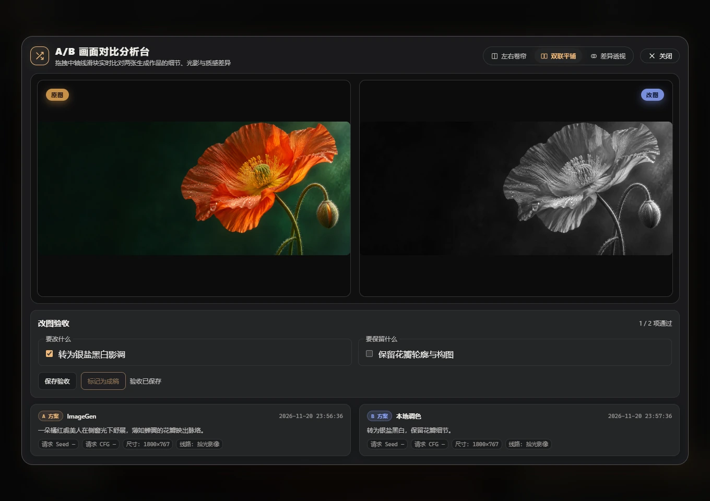
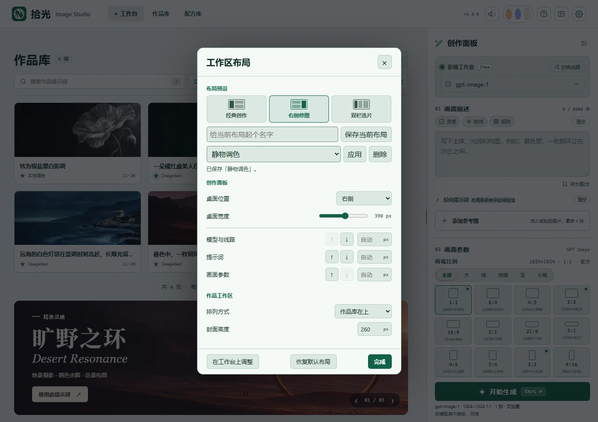

<div align="center">

# Shiguang · AI Image Studio

**Open a past image, recover its prompt and settings, and start the next revision.**

A local desktop browser workspace for people who iterate on the same image. Bring your image API to generate, compare revisions, and deliver the originals.

[Quick start](#quick-start) · [Review an edit](#review-an-edit) · [Make it your workspace](#make-it-your-workspace) · [简体中文](README.md)

<sub>v1.5.0　·　Python 3.10+　·　MIT license</sub>

</div>

[](screenshots/studio.webp)

## When a good image is worth keeping

| What happened | What you can do in Shiguang |
| --- | --- |
| You saved the image. A week later, you need the prompt and model that made it. | Open the image to inspect its recorded settings. Reuse them in the composer, or save a named recipe for a whole series. |
| You asked for a different color treatment. The new version also changed the composition. | Start a revision from the original. List what should change and what should stay, then compare the two versions side by side or with a wipe. |
| You need to deliver the approved files and explain how each was made. | Filter the library to final images, select across pages, and download a ZIP with the originals and a portable `manifest.json`. |

## Review an edit

The original on the left is an orange poppy. The black-and-white study on the right was prepared locally from that same image for this demonstration of the actual review screen.

[](screenshots/review.webp)

**The monochrome treatment is approved. The petal outline and composition still need a second look.** Mark the revision as final once both checks pass. Its link to the original stays in the library.

## Quick start

Install **Python 3.10 or later**. The workspace runs on an ordinary computer. You can explore the interface, arrange panels, and draft prompts before connecting a provider. Generation requires a compatible image API and is billed according to your provider’s terms.

```bash
git clone https://github.com/lmz-666-lmz/aiimage-studio.git
cd aiimage-studio
python -m pip install -r requirements.txt
python app.py
```

The app opens the [local workspace](http://127.0.0.1:7860/) in your browser. You can also [download the source ZIP](https://github.com/lmz-666-lmz/aiimage-studio/archive/refs/heads/main.zip), extract it, and run the last two commands in the folder containing `app.py`.

1. **Connect a provider.** Open the gear in the upper-right corner and add your base URL and API key. Text-to-image uses an OpenAI-compatible `/v1/images/generations` endpoint. Image edits also require `/v1/images/edits`.
2. **Make your first image.** Select a model, write a prompt or use one of the featured scenes, then press `Ctrl + Enter`. Supported models can generate up to four images per submission and accept up to four reference images.
3. **Keep the settings.** Choose **存为配方** (Save recipe) to save the prompt and parameters. Load it later from **配方库** (Recipes) and attach any reference images you want to use.

## Make it your workspace

Open the layout icon in the top bar. Start with Classic, Right-hand retouching, or Side-by-side selection. In direct adjustment mode, drag section headers to reorder them, their bottom edges to change height, and the sidebar divider to change its width. Name and save a layout for each part of your workflow.

[](screenshots/layout.webp)

Settings offers six themes, including the light Celadon and Paper palettes and the darker Darkroom, Ink, Berry, and Marine palettes. The current interface is in Chinese.

## Where your work lives

| What | Where |
| --- | --- |
| Originals, prompts, parameters, favorites, revisions, and review decisions | The project’s `outputs/` folder. Each saved image has an adjacent JSON file. |
| Provider URLs, API keys, and the current theme | Local `config.json`. Use the settings screen or see the [example configuration](config.example.json). |
| Named recipes and layouts | Browser local storage. Use the same browser profile and workspace address to retrieve them. |

<details>
<summary><b>Provider compatibility and task recovery</b></summary>

- **What leaves the computer?** A generation request sends the API key, prompt, and any reference images it uses to the selected provider. The workspace listens on `127.0.0.1` by default. Use a trusted provider with a valid certificate. The current client retries with certificate verification disabled if its initial TLS certificate check fails.
- **Why do the controls change with the model?** The workspace shows size, reference, and quality controls according to the model family. History records requested values. Support for extensions such as Seed and CFG depends on the provider.
- **Can I refresh during a batch?** Reloading the same tab reconnects to a batch or edit task while the server retains it. Images already written to disk are available in the library.

</details>

For compatibility reports, include the model name, steps to reproduce, and the error with any keys removed. [GitHub Issues](https://github.com/lmz-666-lmz/aiimage-studio/issues) · [MIT license](LICENSE)
