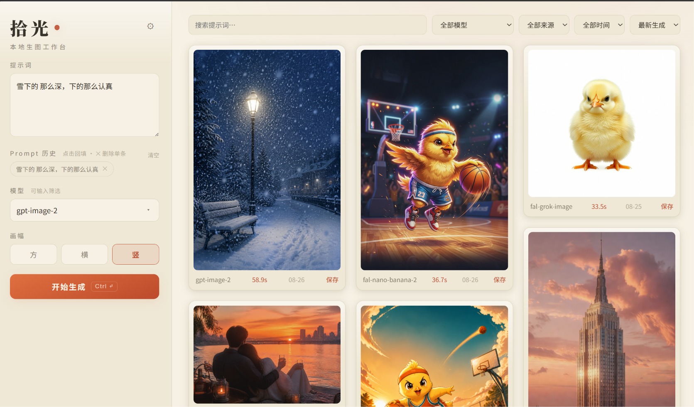
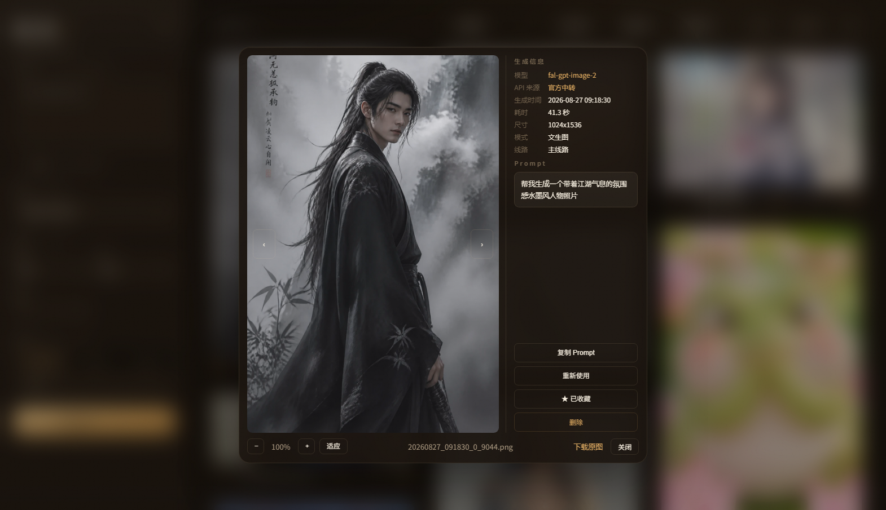

<div align="center">
  
  <h1>AI Image Studio · Shiguang</h1>
  <p><b>A local-first, personal AI image-generation workbench & inspiration gallery — tailor-made for you</b><br>Pooled API keys · multi-model scheduling · batch shooting · metadata traceability · zero GPU / Node dependencies</p>
  <p>
    <a href="https://github.com/lmz-666-lmz/ai-image-studio"></a>
    
    
    
    
  </p>
  <p><a href="README.md">中文</a> · <b>English</b> ｜ Author: <a href="https://github.com/lmz-666-lmz">lmz-666-lmz</a></p>

  
<sub>darkroom theme · masonry history wall · three-step generation panel · favorites & batch management</sub>
</div>

---

## ✨ What is Shiguang?

Shiguang is a **local-first, personal AI image-generation workbench and inspiration gallery, tailor-made for you**: it pools all your API keys for multi-model scheduling, batch shooting and full metadata traceability — on a pure-Python + vanilla-frontend architecture with zero GPU and zero Node dependencies. One command builds your private creative space on a laptop, NAS or Raspberry Pi.

### Pain points it solves

| Your pain point | How Shiguang solves it |
|---|---|
| Several relays, keys scattered everywhere, availability is a lottery | All providers aggregated in one window, health checks at a glance, safe failover to a backup on line failure |
| Good images stuck in platform web pages; prompts lost, parameters unreproducible | A local gallery where every image keeps a sidecar JSON (prompt / model / size / elapsed time / route), with favorites, batch management and one-click export |
| Heavy tooling demands a GPU and piles of dependencies just to use API generation | A single Flask dependency — `python app.py` and you're in |
| Trying a batch of ideas means submitting the same form over and over | One prompt can produce 1–4 images, each appearing on the wall as it lands, with live progress and cancel-anytime |
| Worry that third-party tools upload your keys and artwork | Listens on `127.0.0.1` only; keys and images never leave your machine; the settings API never returns full keys to the browser |

### Highlights

- **Featherweight** — single-file backend + vanilla frontend, three gallery-grade themes, smooth even on old hardware.
- **Aggregation** — manage any number of relays in one place; model capabilities (aspect ratios, quality, background, style, reference images) adapt automatically per model family.
- **Traceable** — the gallery is an archive: any old image can be reopened with its full original parameters.
- **A pleasure to use** — darkroom developing animation, lightbox with zoom & pan, up to 4 reference images for image-to-image, favorites, filters and metadata export.

## 🖼 UI at a glance

<div align="center">
<table>
  <tr>
    <td width="50%" align="center"><br><sub><b>ink</b> theme</sub></td>
    <td width="50%" align="center"><br><sub><b>paper</b> theme</sub></td>
  </tr>
  <tr>
    <td width="33%" align="center"><br><sub><b>Providers</b><br>multi-relay · health checks</sub></td>
    <td width="33%" align="center"><br><sub><b>Developing</b><br>red-lamp sweep · live timer</sub></td>
    <td width="33%" align="center"><br><sub><b>Lightbox</b><br>zoom/pan · traceability · favorite</sub></td>
  </tr>
</table>
</div>

## 🚀 Quick start

```bash
git clone https://github.com/lmz-666-lmz/ai-image-studio.git
cd ai-image-studio
pip install -r requirements.txt   # Flask is the only dependency
python app.py                     # opens http://127.0.0.1:7860
```

First run: click ⚙ Settings → “＋ Add provider” → paste the base URL and key → test the connection → save. You're ready to generate.

Basic flow:

1. Pick or type a model — Shiguang auto-detects its capabilities and shows the matching parameters.
2. Write the prompt: **the whole text is the prompt for this image** — multiple paragraphs are never split apart. Pick 1–4 under “count” to get several images from it.
3. For image-to-image, click “＋ Reference” and choose / drop / paste up to 4 PNG / JPEG / WEBP images.
4. “Generate” or `Ctrl + Enter`. Results are saved to `outputs/` and appear on the history wall.

## ⚙️ Configuration

### Option A: in the UI (recommended)

Add / edit / switch providers and themes in the settings panel; every change is written to the local `config.json` automatically. **The settings API never returns full API keys to the browser**; leaving the key blank while editing keeps the existing one.

### Option B: by file

Copy `config.example.json` to `config.json` and fill it in (upgrades never delete old fields, providers or history):

```json
{
  "name": "Shiguang",
  "theme": "darkroom",
  "failover_enabled": false,
  "providers": [
    {
      "id": "provider_1",
      "name": "Main relay",
      "api_base": "https://example.com",
      "api_key": "sk-…",
      "models": ["gpt-image-1"]
    },
    {
      "id": "provider_2",
      "name": "Backup relay",
      "api_base": "https://example.org/v1",
      "api_key": "sk-…",
      "models": []
    }
  ],
  "active_provider": "provider_1"
}
```

| Field | Type | Description |
|---|---|---|
| `name` | string | App name shown in the top-left corner |
| `theme` | string | `darkroom` / `ink` / `paper` |
| `failover_enabled` | bool | Backup-line switch, off by default |
| `providers[]` | array | Any number of relays |
| `providers[].id` | string | Unique id, auto-generated when absent |
| `providers[].name` | string | Display name |
| `providers[].api_base` | string | API base URL, **with or without `/v1`** — both are handled |
| `providers[].api_key` | string | Stored locally only; never commit it |
| `providers[].models` | array | Model cache, auto-populated on first use |
| `active_provider` | string | Id of the provider currently in use |

### Supported platforms

Anything implementing the OpenAI-compatible `/v1/images/generations` (and `/v1/images/edits` for image-to-image) works:

| Platform / form | Example `api_base` | Notes |
|---|---|---|
| OpenAI official | `https://api.openai.com` | `gpt-image` / `dall-e` families, parameters aligned to official constraints |
| new-api / one-api relays | `https://your.relay` | The most common form; `/v1` suffix optional |
| Model platforms (SiliconFlow etc.) | `https://api.siliconflow.cn` | `flux` and other image models |
| Self-hosted / other compatible | any | Unknown model names fall back to a **Generic OpenAI Compatible** profile instead of being rejected |

Model-family detection covers `gpt-image`, `dall-e`, `nano-banana / banana`, `gemini image`, `seedream`, `flux`, `grok image` and friends — relay-renamed variants (hyphens, underscores, casing) are normalized automatically.

### Runtime files

- `outputs/` — generated images plus sidecar `.json` metadata (prompt / model / size / elapsed / route / favorite).
- `runtime_state.json` — runtime state such as health records; created automatically, safe to delete.
- These and `config.json` are all in `.gitignore`.

## 🎛 v1.3.0 feature list

| Feature | Details |
|---|---|
| **Capability auto-adaptation** | Sizes, quality, background, style, count and reference-image entry adapt per model family; unsupported fields are filtered before sending to avoid upstream 400s. A "what will be sent" panel lists the parameters that actually go out. |
| **A count that really works** | Official `gpt-image` / `gemini image` / `grok image` return exactly one image per call, so extra images are requested sequentially until the chosen count is met; families that do accept `n` (`dall-e` / `seedream` / `flux`) are asked for the whole batch first and topped up only if short. Shortfalls are reported honestly, and a failed top-up keeps the images already produced. |
| **Multi-reference image-to-image** | Up to 4 PNG / JPEG / WEBP images; single reference uses the `image` field, multiple use `image[]` per the official convention. |
| **Whole prompt = one image** | Everything in the prompt box (multiple paragraphs and newlines included) is sent verbatim as a single prompt; nothing is split by line or blank line. Use the count control to get more images. Progress shows live on the wall and cancel takes effect before the next upstream request. |
| **14 aspect ratios** | 1:1 / 5:4 / 4:3 / 3:2 / 16:9 / 2:1 / 21:9 / 3:1 / 4:5 / 3:4 / 2:3 / 9:16 / 1:2 / 9:21, grouped as square / landscape / portrait / wide / tall. Each tile draws the real ratio and prints the pixel size; official sizes carry a filled dot. Custom width×height still passes through untouched. |
| **Automatic size fallback** | If the relay only accepts its official sizes (400/422), the request is retried once at the family's official size instead of wasting the attempt, and the metadata records both the requested and the actual size. |
| **Traceable, reusable parameters** | Quality / background / style / size / count / references are written into the sidecar JSON, shown in the lightbox, and restorable with one click via “reuse all parameters”. |
| **Favorites & batch management** | Star favorites, favorites-only filter, lightbox favorite toggle; checkbox batch delete; one-click JSON export of all metadata. |
| **Provider health checks** | Async `GET /v1/models` probes (never generates, so no cost), showing healthy / slow / rate-limited / unavailable plus latency, cached for 45s and probed in parallel across providers; generation time is no longer mixed into the health latency. |
| **Upstream errors, translated** | Generation failures now append the concrete reason returned by the relay (the `error.message` and friends), instead of a bare HTTP status code. |
| **Safe failover** | Only on 401 / 403 / 404 / 429 / 502 / 503 / 504 or a clear connection failure, one retry against a backup that caches the same model; never on ambiguous timeouts, and never mid-batch, so one group of images keeps a consistent look. |
| **Local history & three themes** | Masonry wall, filters, pagination, lightbox, developing animation; an in-memory index keeps it fast with thousands of images. |

<details><summary><b>Changes since v1.2.0</b></summary>

- **Accessibility pass** — a global `prefers-reduced-motion` fallback (all looping animations stop), a consistent keyboard `:focus-visible` ring, and the card action overlay is now always visible on touch devices (it was hover-only and unreachable there).
- **Dialog exit animations** — the lightbox and settings window fade out smoothly on close (previously they vanished instantly); panning in the lightbox disables the transform transition so dragging tracks the pointer 1:1.
- **Scroll-reveal gallery** — cards now animate in as they enter the viewport (staggered above the fold); switching between Masonry / Grid / Cinema gets a light re-entrance animation.
- **Micro-interactions** — favorite star pop, determinate progress shimmer with percentage readout, toasts slide in from the right with a distinct info style, floating empty-state frame, and an exposure veil on theme switch.
- **Dialog "blink" fixed** — the lightbox / settings / toast entrance animations passed a transition variable inside the `animation` shorthand, so its second time value was parsed as a 250–500 ms delay: the dialog rendered fully, snapped invisible, then faded in. The delay is now zero and dialogs fade in directly.
- **Cross-theme consistency fixes** — danger hovers, invalid-input rings, the health pulse, dropdown chevrons, the developing-paper backdrop and the generate-button gradient tail are all token-driven now, so the light paper theme no longer inherits dark-theme color values.
- **Mobile hardening** — grid/cinema column adaptation at narrow widths, batch-bar and lightbox spacing, full-width toasts, scrollable settings panel on small screens.
- **Bug fixes** — entries whose upstream URL fetch failed no longer count toward completed images; a failed batch task no longer clears the reference images (consistent with single-image generation); the developing placeholder no longer inherits a stale size for families that reject sizes; non-JSON relay responses now produce a readable Chinese error; and **generation-path errors now really carry the relay's own reason** (the health record used to consume the error body first, so the user-facing message lost details like "insufficient quota").
</details>

<details><summary><b>Changes since v1.1.0</b></summary>

- **Grok family detection fixed** — real ids like `grok-2-image` normalize to "grok 2 image", which never contained the old "grok image" matcher, so they fell through to the generic profile and sent `size`, which the official xAI API rejects with 400. The matcher is now the bare keyword "grok", and the size field is omitted entirely for that family.
- **Size field filtered by capability** — families with `size_mode = none` no longer carry a stale size on either end, matching the UI hint "this family does not accept a size".
- **Errors carry the reason** — 401/429/400 and friends now append the relay's own JSON reason (first 160 chars), so "insufficient quota" or "model not found" is visible at a glance.
- **Parallel health checks** — multiple providers are probed concurrently (backend and frontend), so one hanging relay no longer stalls the rest.
- **TLS warnings never lost** — the certificate-downgrade notice now flows through sync generation, the task queue and error responses, surfaced as a toast.
- **Wider model discovery** — the `/v1/models` keyword filter now also catches stable-diffusion / sd / cogview / wan / kolors / janus / ideogram / recraft families.
- **Details** — reference thumbnail objectURLs are revoked after use (long-session memory leak); the `/` search shortcut no longer fires while the lightbox or settings dialog is open; the favorites filter button keeps its icon markup.
</details>

<details><summary><b>Changes since v1.0.3</b></summary>

- **"I picked a count but still got one image" is fixed** — the count is now its own segmented control, and the backend tops up to the requested number.
- **No more guessing at parameters** — the new "what will be sent" panel spells out model / size / quality / background / style / count / mode and which fields the family ignores.
- **Health no longer lies** — generation time is no longer recorded as health latency (it used to read "healthy 42706ms").
- **Steadier tasks** — a stale task id now ends cleanly instead of leaving the button stuck on "cancel"; single-prompt multi-image and multi-paragraph batches share one pollable, cancellable queue.
- **Details** — the last used model is remembered, settings show the version and limits, the empty state is no longer removed for good, and the lightbox lists reference-image sources.
</details>

## 🖼 Reference images & history metadata

Reference images are capped at 10MB each, up to 4. Models known not to support edits show a light hint; unknown models keep the generic compatible mode and the relay has the final say. Image-to-image records write a sidecar `.json`:

```json
{
  "mode": "image-to-image",
  "reference_used": true,
  "reference_name": "reference.png",
  "reference_count": 1
}
```

Text-to-image uses `mode: "text-to-image"` and `reference_used: false`; favorites write `"favorite": true`. Older history without these fields still displays fine.

## 🩺 Health states & failover

States: `healthy` (<1.5s) · `slow` (≥1.5s) · `rate_limited` (429) · `unavailable` (connection failure / 502 / 503 / 504).

With failover enabled, a clear line-level failure on the active provider triggers at most one extra request, against a backup whose cached model list contains the **same model name**; a successful switch is recorded in the image metadata:

```json
{ "provider_id": "provider_x", "provider_name": "Backup relay", "failover": true, "failover_from": "Main relay" }
```

## 📁 Project structure

```text
ai-image-studio/
├── app.py              # single-file backend: API, capability detection, generation queue, health & failover
├── requirements.txt    # Flask only
├── config.example.json # configuration template
├── README.md           # 中文文档
├── static/index.html   # page structure
├── static/style.css    # three gallery-grade themes
├── static/app.js       # generation, image count, references, wall, favorites, lightbox, GSAP motion
├── screenshots/        # README previews
└── outputs/            # generated images + sidecar JSON (created at runtime)
```

## ❓ FAQ

<details><summary><b>Do my API keys or images get uploaded anywhere?</b></summary>

No. Shiguang listens on `127.0.0.1` only; keys live in the local `config.json`, images in the local `outputs/`; requests go only to the providers you configured. The settings API never returns full keys to the browser.
</details>

<details><summary><b>Why does a model lack quality / background parameters?</b></summary>

Parameters are shown per detected capability and unsupported fields are filtered before sending, to avoid upstream 400s. Unknown models use the Generic profile.
</details>

<details><summary><b>Why is the image-to-image button disabled?</b></summary>

Known models that don't declare `image_to_image` show a hint; switch to an edits-capable model. Unknown models are never preemptively blocked — the relay has the final say.
</details>

<details><summary><b>Why didn't a failed generation switch providers?</b></summary>

Failover is off by default and only reacts to clear line failures (429 / 502 / 503 / 504 or connection failure), once, and only to a backup caching the same model. 400 / 401 / 403 and ambiguous timeouts are never retried, to avoid duplicate generation and billing.
</details>

<details><summary><b>Do health checks cost money?</b></summary>

No — they only call `GET /v1/models`, cached for 45 seconds.
</details>

<details><summary><b>Will upgrades keep my config and history?</b></summary>

Yes. Legacy single-provider `api_base` / `api_key` configs auto-migrate to the providers list; old images and JSON stay readable; new fields get defaults.
</details>

---

MIT License · AI Image Studio · Shiguang · v1.3.0
